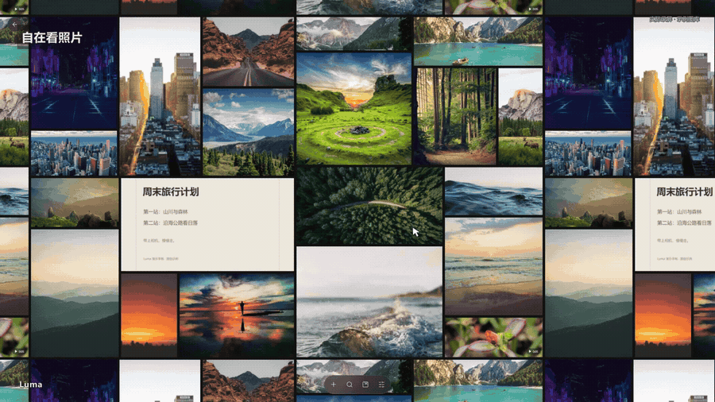
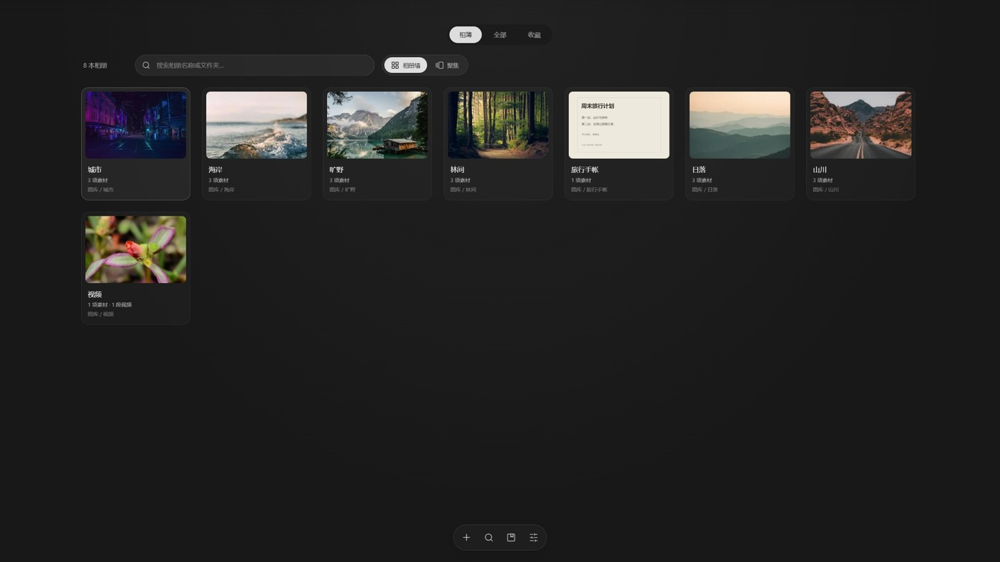

# Luma

**把散落在文件夹里的照片，变成一面可以漫游的照片墙。**

A local-first photo and video library for Windows, with an infinite mosaic wall,
quiet translucent controls, folder albums and optional offline AI search.

[](#下载与安装)
[](LICENSE)
[](#验证与贡献)

[**下载 Windows x64 安装包**](https://github.com/Loya-art/luma/releases/download/v1.2.3/Luma-1.2.3-Setup.exe)

[](https://github.com/Loya-art/luma/releases/download/v1.2.3/Luma-demo-1080p.mp4)

[版本与下载](https://github.com/Loya-art/luma/releases/tag/v1.2.3)
· [观看实际操作演示](https://github.com/Loya-art/luma/releases/download/v1.2.3/Luma-demo-1080p.mp4)
· [反馈问题](https://github.com/Loya-art/luma/issues)
· [English overview](#english)

演示约 52 秒，1920×1080 / 30 fps，以实际操作录屏为主，展示照片墙、相簿切换、
视频播放、目录预览和真实本地搜索。公开成片使用独立示例图库，本机目录已作隐私遮挡。

## 灵感来源

Luma 的沉浸式拼贴、向四周延伸的照片墙和半透明控件，灵感来自
[Folia](https://github.com/chthollyphile/folia-major)。感谢 Folia 作者与贡献者。
Luma 将这种浏览体验用于电脑上的本地照片、视频与文件夹相簿。

## 能做什么

- **可以漫游的照片墙**：拖动、滚轮缩放；少量照片也能重复铺满四周。
  单击照片平滑放大并居中，双击打开原图；视频单击直接播放。
- **按你的偏好排版**：均衡、查看次数、拍摄时间和文件体积四种尺寸规则。
- **文件夹相簿**：首页总览带封面、名称和路径，支持搜索；相簿内用底部封面列表切换。
- **先预览，再扫描加入**：先展示推荐目录，默认不勾选，40 个一批加载。
  保留游戏截图、ComfyUI output，默认跳过常见贴图、聊天存储、软件素材和缓存。
- **手机无线传入**：同一 Wi-Fi 下扫码打开手机浏览器，选择照片与视频发送。
  不需要开发者模式，支持内容去重；也保留高级 ADB 导入方式。
- **本地文字与内容搜索**：可选 PaddleOCR / RapidOCR 与 Chinese-CLIP，
  搜图中文字，也能搜“山川”“人物”“海边合照”等画面内容。
- **智能相簿与人工修正**：分类只建立关联，不搬动原件；人工修改优先。
- **原件留在原处**：图库保存索引与预览。删除照片会在确认后移至 Windows 回收站；
  移除来源文件夹或删除虚拟相册只解除整理关系。



## 下载与安装

适用于 Windows 10/11 x64。下载
[Luma-1.2.3-Setup.exe](https://github.com/Loya-art/luma/releases/download/v1.2.3/Luma-1.2.3-Setup.exe)，
双击安装，然后从桌面的 **Luma** 打开。普通使用无需安装 Node.js、Python 或 FFmpeg。
本地 AI 模型在首次启用识别时下载。

已有版本可安装到原位置升级，继续使用已有图库、分类和导入记录。

## 从源码运行

也可以自行运行或构建源码。开发环境为 Windows 和 Node.js 24 或更新版本。

```powershell
git clone https://github.com/Loya-art/luma.git
cd luma
npm ci
npm run dev
```

视频探测、预览和兼容播放需要 `ffmpeg.exe` 与 `ffprobe.exe` 在 PATH 中，
也可设置 `FFMPEG_PATH` 和 `FFPROBE_PATH` 后运行 `npm run prepare:binaries`。
从源码使用高级 ADB 导入前运行 `npm run prepare:phone`，使用本地 AI 前运行
`npm run prepare:ai`，以准备相应的独立运行组件。

构建 Windows 安装包：

```powershell
npm run dist
```

产物为 `release/Luma-1.2.3-Setup.exe`。打包脚本准备 FFmpeg、Google ADB、uv 和图标。
FFmpeg 由本机 PATH 提供；ADB 与 uv 从官方分发下载。各组件许可见
[THIRD_PARTY_NOTICES.md](THIRD_PARTY_NOTICES.md)。
本仓库不包含第三方运行程序、模型权重、私人照片、图库数据库和本机验收记录。

## 使用说明

**添加照片**：底部“＋ → 从电脑文件夹添加”，或者拖入文件夹。包含照片的子目录
各自成为相簿。通过“扫描电脑照片”加入的目录只读取本层照片，子目录分别勾选。
扫描数量表示候选目录数，只有选择加入的目录才成为管理来源。

**手机传入**：“＋ → 手机无线传入”，选择电脑保存位置和相册名称，点击开始接收。
手机和电脑需互相连通，防火墙需允许局域网连接；手机浏览器只发送主动选中的文件。
仅在云相册里的原图需先下载到手机。停止接收、关闭软件或会话到期后，链接失效。
普通 USB 可先通过 Windows 文件传输复制到电脑，再添加文件夹。

**本地 AI**：“智能整理”首次下载托管 Python、OCR 与图文模型，无需手动安装 Python。
准备完成后在本机识别与检索，索引完成后可离线搜索。人物分类表示画面里有人，
暂不按具体人脸分组；视频可以管理与备份，本期智能识别覆盖静态图片。

**可选云端增强**：配置 DeepSeek 后，仅当主动发送所选照片分析时上传分析副本。
密钥使用系统保护的本地存储保存，服务和模型必须支持所配置的图片输入接口。
AI 生成相册封面尚未实现，不包含在本次演示中。

**HEIC/HEIF**：保留原件，通过 libheif 生成预览；不能解码时显示错误。

**现有用户升级**：分类、查看次数、手机导入与识别任务继续保存在
`%APPDATA%/拾光/`；品牌改为 Luma 后保留旧目录以兼容已有图库。

## 快捷操作

| 操作 | 按键 |
| --- | --- |
| 照片墙漫游 | 鼠标拖动 |
| 缩放 | 滚轮 |
| 照片放大居中 | 单击 |
| 打开原图 | 双击 / Enter |
| 播放视频 | 单击 / Enter |
| 多选 / 连续选择 | Ctrl / Shift + 单击 |
| 搜索 | Ctrl + F |
| 返回相簿 | Ctrl + B |
| 关闭查看器 / 取消聚焦 | Esc |

## 验证与贡献

```powershell
npm run typecheck
npm test
npm run build
```

`npm test` 首次获取校验 SHA-256 的上游公开 HEIC 样本。测试覆盖索引、原件保护、
重复导入、中断恢复、OCR/内容索引接口、目录筛选和无限布局。
桌面验证脚本在 `tests/`，使用隔离配置并在结束时关闭测试进程。
需要私人图库或安装回执的本机回归脚本不属于默认测试。自动化检查模板在
[`docs/ci/`](docs/ci/)，本次首次发布尚未启用 GitHub Actions。

问题报告和贡献见 [CONTRIBUTING.md](CONTRIBUTING.md)。这是持续迭代中的个人项目，
实际使用反馈比功能清单更有帮助。

## English

Luma is a Windows desktop photo and video manager built with Electron, React,
TypeScript and SQLite. It references existing folders instead of moving original
files. An infinite mosaic wall, folder-album overview, translucent controls and
direct video playback support everyday browsing. Optional local OCR and
Chinese-CLIP enable text and semantic search; cloud analysis is an explicit
per-selection action.

Visual interaction is inspired by [Folia](https://github.com/chthollyphile/folia-major).
Demo footage is captured from the real app with a separate public-media library.
See [media credits](docs/media/credits.md) and [third-party notices](THIRD_PARTY_NOTICES.md).

## License

[AGPL-3.0-only](LICENSE) · Copyright © 2026 Loya-art and Luma contributors.
Third-party dependencies, programs, models and demo media retain their own licenses.
